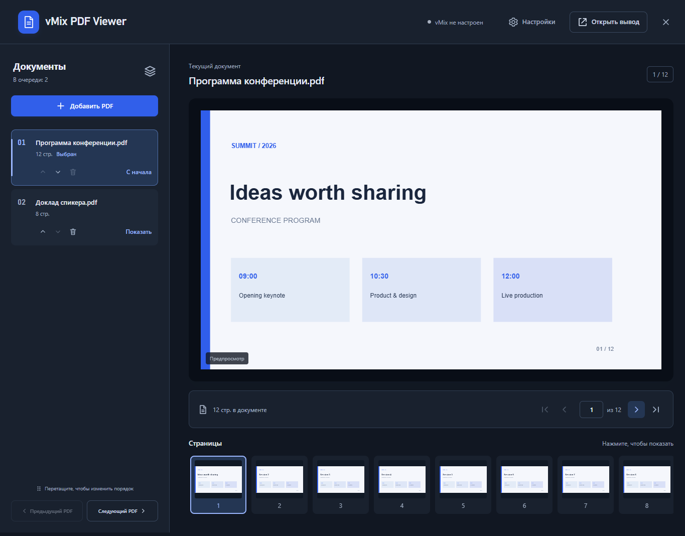
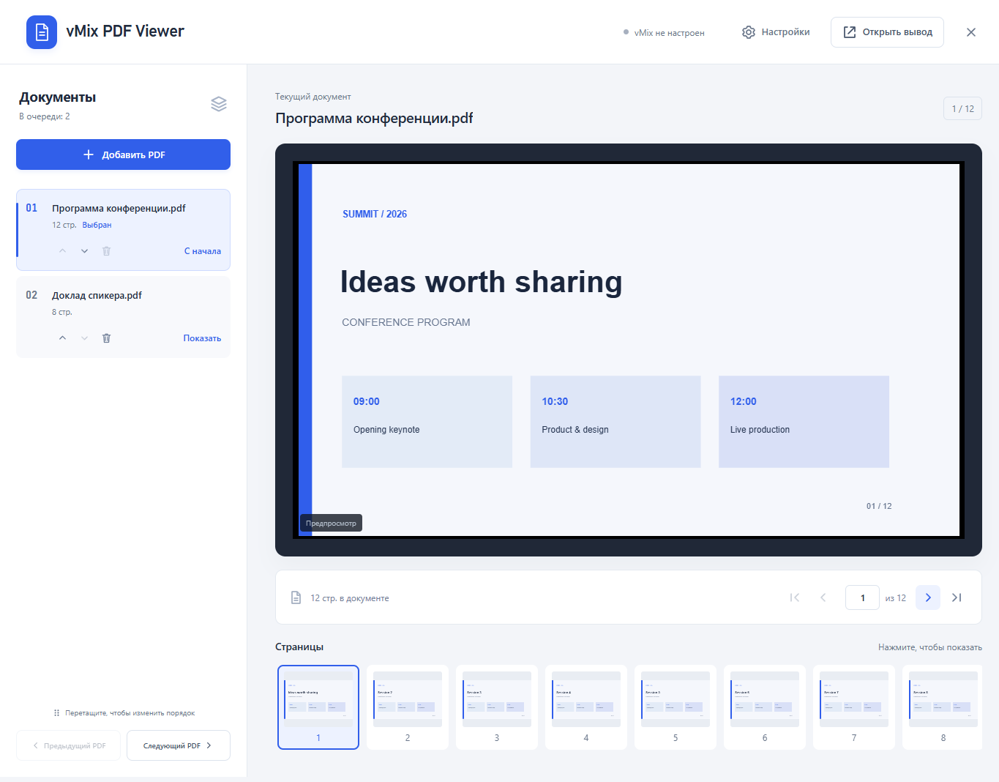

# vMix PDF Viewer

[Русский](README.md) | **English**

A local Windows app for displaying PDFs through a **Web Browser Input in vMix**.
Manage a document library, switch pages, use ready-made keyboard commands,
and choose a light or dark theme. Windows x64. An independent open-source project
licensed under MIT.

[Download](https://github.com/svenasven/vmix-pdf-viewer/releases/latest) ·
[User guide](docs/en/user-guide.md) ·
[Report a bug](https://github.com/svenasven/vmix-pdf-viewer/issues)



## Features

- Add, remove, and reorder multiple PDFs during an event.
- Protect the active PDF: changes to the queue do not change the current presentation.
- Preview, page thumbnails, and navigation between pages and documents.
- A vMix connection wizard, source diagnostics, and connection recovery.
- Ready-made page and document commands; Page Up / Page Down through vMix Shortcuts.
- Local network access and automatic selection of an available port.
- Remember the last page and document order; save the library in a single backup file.
- Closing the window hides it in the taskbar while the presentation continues.
- **Click the logo to switch themes.** Your choice survives a port change;
  the PDF itself keeps its original colors.

<details><summary>Light theme</summary>



</details>

Screenshots use documents created for demonstration, not users' documents.

## Quick start

1. Download and run `vMix-PDF-Viewer-0.10.1-Windows.exe` from Releases.
2. Add your PDFs. Open **Settings → Set up vMix → Find vMix**
   (**Настройки → Настроить vMix → Найти vMix**).
3. Select an existing source or add a new one using the wizard.
4. For keyboard control, install the commands provided by the wizard and assign them in vMix Shortcuts.

Choose Russian or English in Settings → Language. The choice is saved across restarts and port changes.

The EXE does not require a separate Node.js installation. To quit completely,
right-click the system tray icon and choose **Quit (Выйти)**.

## Compatibility and status

**Version 0.10.1.** Integration has been tested with vMix Trial 29.0.0.49.
Commands require a vMix edition that supports Scripting.

The connection and presentation resume automatically after restarting vMix.

Existing libraries remain in `%APPDATA%/PDF Viewer/library`.
Legacy sources named `PDF Viewer @port` remain compatible with installed commands.
New sources use `vMix PDF Viewer @port`.

## Run from source

Requires Node.js 24+. The desktop app and portable build target Windows x64.

```powershell
npm ci --omit=optional
npm test
npm run desktop
```

`npm start` runs the server without a desktop window. `npm run build:win` creates
a portable EXE in `release/`. Port selection starts at 18765. An internet connection
is needed to install dependencies and build initially; PDF.js resources are served
locally during presentations.

## Documentation

- [User guide](docs/en/user-guide.md)
- [Architecture](docs/en/architecture.md)
- [Development and builds](docs/en/development.md)
- [Validation](docs/en/validation.md)
- [Networking and data](docs/en/security.md)
- [Contributing](CONTRIBUTING.en.md)

Devices on the same local subnet can control the presentation and document library.
Use a trusted network: the app does not include user authentication.

## License

[MIT](LICENSE), © 2026 [svenasven](https://github.com/svenasven).
Third-party components retain [their own licenses](THIRD_PARTY_NOTICES.en.md).
This project is not an official vMix product.
