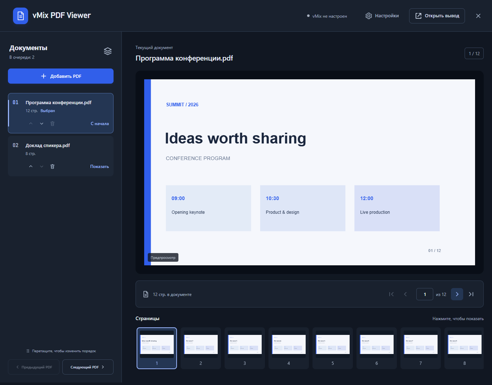
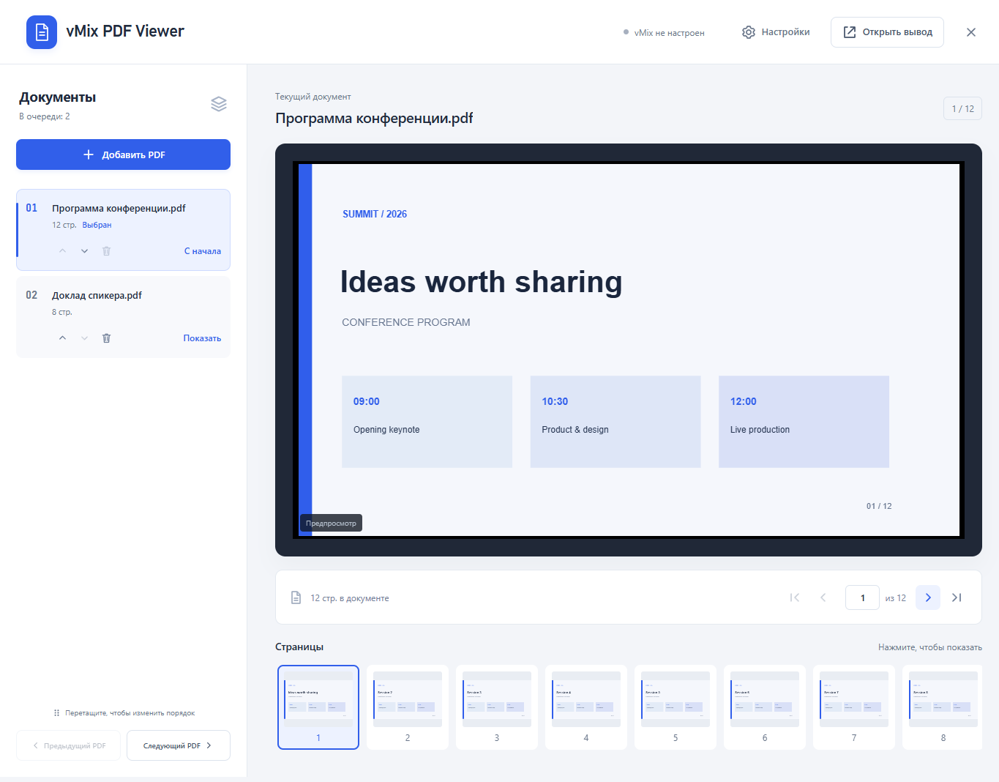

# vMix PDF Viewer

**Русский** | [English](README.en.md)

Локальное приложение для показа PDF через **Web Browser Input в vMix**.
Библиотека документов, управление страницами, готовые команды для клавиатуры,
светлая и тёмная темы. Windows x64. Открытый независимый проект, лицензия MIT.

[Скачать приложение](https://github.com/svenasven/vmix-pdf-viewer/releases/latest) ·
[Руководство](docs/user-guide.md) ·
[Сообщить об ошибке](https://github.com/svenasven/vmix-pdf-viewer/issues)



## Возможности

- Несколько PDF в очереди, добавление, удаление и перестановка во время мероприятия.
- Защита активного PDF: изменение очереди не меняет текущий показ.
- Предпросмотр, миниатюры и переходы между страницами и документами.
- Мастер подключения vMix, диагностика и восстановление связи.
- Готовые команды страниц и документов; Page Up / Page Down через vMix Shortcuts.
- Доступ из локальной сети и автоматический выбор свободного порта.
- Последняя страница и очередь сохраняются, резервная копия — одним файлом.
- Крестик скрывает окно в значок рядом с часами, показ продолжается.
- **Нажатие на логотип переключает тему.** Выбор сохраняется после смены порта;
  цвета самих PDF не меняются.

<details><summary>Светлая тема</summary>



</details>

Скриншоты показывают созданную для примера библиотеку, не пользовательские документы.

Язык интерфейса: русский или английский, переключение в настройках.

## Быстрый запуск

1. Скачайте `vMix-PDF-Viewer-0.10.1-Windows.exe` из Releases и запустите.
2. Добавьте PDF. Откройте **Настройки → Настроить vMix → Найти vMix**.
3. Выберите существующий источник или добавьте новый через мастер.
4. Для клавиш управления установите готовые команды из мастера и назначьте их в vMix Shortcuts.

Node.js готовому EXE не нужен. Для полного выхода:
правой кнопкой по значку рядом с часами → **Выйти**.

## Совместимость и статус

**Версия 0.10.1.** Интеграция проверена на vMix Trial 29.0.0.49.
Для команд нужна редакция vMix с поддержкой Scripting.

После перезапуска vMix подключение и показ восстанавливаются автоматически.

Существующая библиотека остаётся в `%APPDATA%/PDF Viewer/library`.
Старые источники `PDF Viewer @порт` сохраняют совместимость с установленными командами.
Новые получают имя `vMix PDF Viewer @порт`.

## Из исходников

Нужен Node.js 24+; для окна и сборки — Windows x64.

```powershell
npm ci --omit=optional
npm test
npm run desktop
```

`npm start` — сервер без окна. `npm run build:win` — переносимый EXE в `release/`.
Свободный порт выбирается начиная с 18765. Интернет требуется для установки
зависимостей и первоначальной сборки; во время показа ресурсы PDF.js локальные.

## Документация

- [Руководство оператора](docs/user-guide.md)
- [Архитектура](docs/architecture.md)
- [Разработка и сборка](docs/development.md)
- [Проверки и ограничения](docs/validation.md)
- [Сеть и данные](docs/security.md)
- [Участие в разработке](CONTRIBUTING.md)

Устройства той же локальной подсети могут управлять показом и библиотекой.
Используйте доверенную сеть: встроенной авторизации пользователей нет.

## Лицензия

[MIT](LICENSE), © 2026 [svenasven](https://github.com/svenasven).
Сторонние компоненты сохраняют [свои лицензии](THIRD_PARTY_NOTICES.md).
Проект не является официальным продуктом vMix.
